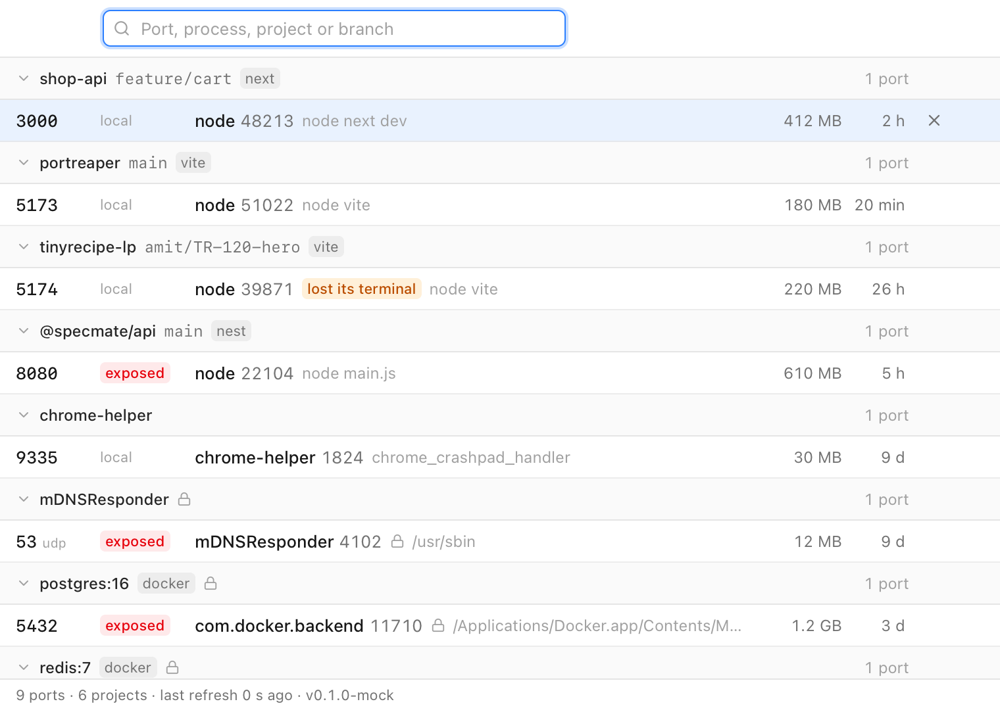

# PortReaper

**Kill ports. See what is behind them.**

PortReaper is a small macOS app that lists every listening port on your machine, names the
project and git branch behind each one, and kills the process in one click. It lives in the Dock
and in the menu bar. Instead of `node 48213` you see `shop-api · feature/cart · vite`.

Status: **v0.2 in progress, macOS only.** Nothing is released yet; what follows is what v0.2 is
being built to do, work package by work package.



*Mock data, from the browser build (`pnpm dev`), 760×540. Regenerate with `pnpm screenshot`;
`docs/screenshot-dark.png` is the same window in dark mode.*

## The instant flow

Port 3000 is taken and you do not know by what. Press ⌘⇧K from any app. A strip appears over
whatever you are doing, with the port most likely in your way already selected: a dev server
whose terminal is gone, then a port PortReaper freed a minute ago that something else grabbed,
then the most recently started dev server. Type `3` to narrow it to :3000 (a process or project
name works too), press ↵. The process gets SIGTERM, up to 3 s to close its sockets, then SIGKILL.
The strip reads `Freed :3000 · node (48213)`, disappears about 180 ms later, and focus is back in
your terminal.

⌥↵ sends SIGKILL at once. A protected process (database, Docker, system daemon) asks for ↵ a
second time. Esc backs out one step: disarms, clears the query, hides the strip.

## What it does

- **Every listening port, classified.** TCP and UDP, IPv4 and IPv6 merged, each with the process
  behind it (name, command line, working directory, user, memory, uptime) and a category: `web`
  (3000–3010, 5173 and up, 4200), `api` (8000, 8080, 5000, 4000), `db`, `ai` (Ollama, LM Studio,
  vLLM: the ones holding gigabytes of models), `system`, `other`. When the command line gives the
  stack away it is named: Next.js, NestJS, PostgreSQL, Ollama. A port bound to every interface
  carries a public-LAN badge. A dev server that lost its terminal is a zombie; "Reap zombies"
  frees them all at once.
- **The project behind the port.** Name from `package.json`, `Cargo.toml`, `pyproject.toml` or
  `go.mod` (else the folder), the git branch read from `.git/HEAD` (worktrees included), and the
  tool from the command line: `vite`, `next`, `node`, `docker`, `postgres`... When it is not sure
  it shows nothing rather than a guess.
- **The drawer.** Open a row and you get the process tree from launchd down, the working
  directory, the branch, the bind address, the full command line, and two buttons: Kill, and
  Restart, which kills and starts the same command again in the same directory.
- **The Taskline.** Everything PortReaper did this session, newest first: when, how long the kill
  took, how much memory it gave back. Kills from the menu bar and from the strip are in it too,
  because the core keeps the log, not the window. Relaunch brings a killed process back from its
  remembered command and working directory.
- **Kill in one click.** SIGTERM, up to 3 s to close sockets cleanly, then SIGKILL. ⌥-click
  sends SIGKILL at once. "Kill all" frees a whole project.
- **Guards.** It never signals pid 0, pid 1 or itself. Databases, Docker, system daemons and
  other users' processes are protected and ask a second time before dying, in the window and in
  the strip alike.
- **One window, one search box.** Dark only. Grouped by project, filtered by category pill,
  keyboard driven (↑ ↓ Enter ⌘⌫ Esc, type a port number to search), refreshed every 2 s while
  visible; the header shows the live count and the real round-trip of the last scan. Row
  actions: open `localhost:<port>` in the browser, copy `kill -9 <pid>`, copy the command line,
  reveal the project folder.
- **Menu bar.** An icon with the count of open ports and one "Free :3000 · shop-api" item per
  port. ⌘⇧P brings the window up from anywhere. Closing the window hides it; the app stays in the
  Dock; Quit lives in the tray menu and the app menu.
- **Nothing leaves the machine.** No analytics, no network calls, no crash reporting.

## Install

There is no download yet. Build it from source (Xcode Command Line Tools, Rust stable 1.85+,
Node 24, pnpm 11). Clone the repository, then:

```bash
pnpm install
pnpm tauri build --bundles app
open src-tauri/target/release/bundle/macos/PortReaper.app
```

Once the repository has a GitHub remote, CI (`.github/workflows/ci.yml`) builds an unsigned
`.app` for every push that can be downloaded from the workflow run.

## Develop

```bash
pnpm tauri dev                                    # the app, with hot reload
pnpm dev                                          # the UI alone, in a browser, against a mock core
pnpm check                                        # Biome, vue-tsc, Vitest
pnpm e2e                                          # Playwright (WebKit, Chromium) against the mock core
cargo test --manifest-path src-tauri/Cargo.toml   # the Rust core (opens real sockets, kills only children it spawned)
pnpm icons                                        # regenerate every icon from design/*.svg
```

## How it works

A Rust core (Tauri 2) reads listening sockets with the `listeners` crate and process details with
`sysinfo`, walks up from each process's working directory to find its project manifest and
`.git/HEAD`, and classifies the port from its number and command line. The same core records
every kill in the Taskline and remembers the command and directory for Relaunch, so the window,
the strip and the menu bar all see one history. A Vue 3 window asks the core for the list every
2 s while visible and sends kill requests back; `src-tauri/src/model.rs` and `src/types.ts` are
the contract between the two. The look is described in [`design/README.md`](design/README.md).

## FAQ

**Why is the app unsigned?**
There is no Apple Developer certificate yet. An app you build yourself opens normally. A
downloaded build carries macOS's quarantine flag and is refused on first launch: open
System Settings → Privacy & Security and click "Open Anyway", or run
`xattr -dr com.apple.quarantine PortReaper.app`.

**What does it read, and where does it go?**
The list of listening sockets, and for each process behind one: pid, name, command line, working
directory, executable path, user, memory, start time and parent pid. It reads them to show them
and to find the project. Nothing is sent anywhere: the core's dependencies
(`src-tauri/Cargo.toml`) contain no HTTP client, the UI is bundled with the app and loads nothing
remote, and there is no analytics SDK.

**Why does it not ask for sudo?**
Your own processes can be listed and signalled by your own user, and a dev server is your own
process. Processes of other users (root daemons, for example) show up with what the kernel reveals
to a normal user and cannot be killed; the app says so instead of asking for a password. There is
no privileged helper.

## License

MIT, see [LICENSE](LICENSE).
