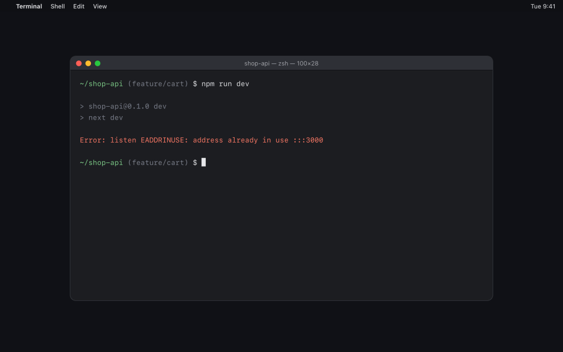
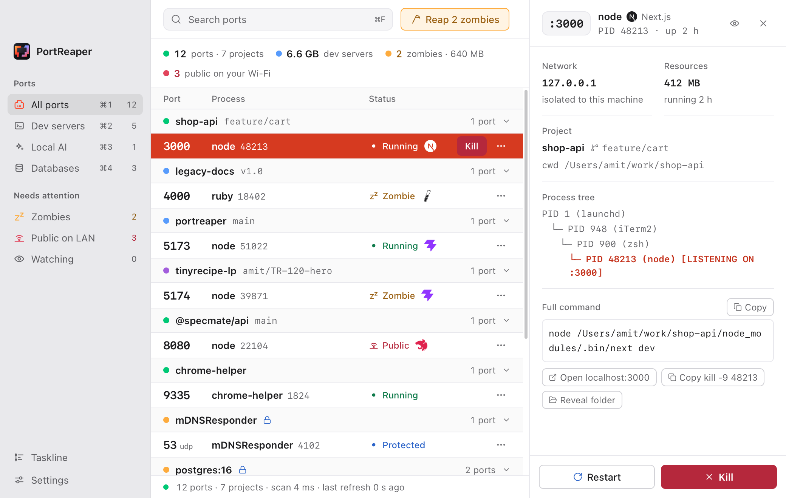

# PortReaper

**Kill ports. See what is behind them.**

[](https://github.com/amitgal45/portreaper/releases/latest)  [](LICENSE) [](#homebrew)



*EADDRINUSE, ⌘⇧K, type 3000, Enter. The dev server starts.*

PortReaper is a small macOS app that lists every listening port on your machine, names the
project and git branch behind each one, and kills the process in one click. It lives in the Dock
and in the menu bar. Instead of `node 48213` you see `shop-api · feature/cart · vite`.

Status: **v0.5, macOS (Universal: Apple Silicon & Intel).** Signed with an Apple Developer ID,
notarized, and auto-updating.

## Why I built this

Coding agents leave things running. When a Claude Code or Cursor session ends, its dev servers,
MCP servers, Playwright browsers and test workers are often still there. Every time a port was
taken I ran `lsof -i :3000`, then `kill`. The ones that hold no port never showed up in `lsof -i`
at all. I wanted to see which project and branch each process belongs to, and free it
in one keystroke. So I built PortReaper.

<!-- Draft by Shimi from Amit's notes: Amit rewrites this in his own words. -->

## The instant flow

Port 3000 is taken and you do not know by what. Press ⌘⇧K from any app. A strip appears over
whatever you are doing, with the port most likely in your way already selected: a dev server
whose terminal is gone, then a port PortReaper freed a minute ago that something else grabbed,
then the most recently started dev server. Type `3` to narrow it to :3000 (a process or project
name works too), press ↵. The process gets SIGTERM, up to 3 s to close its sockets, then SIGKILL.
The strip reads `Freed :3000 · node (48213)`, disappears about 180 ms later, and focus is back in
your terminal.

⌥↵ sends SIGKILL at once. A protected process (database, Docker, system daemon, a launchd job
that may start again) asks for ↵ a second time. Esc backs out one step: disarms, clears the
query, hides the strip.

## What it does



*Mock data, from the browser build (`pnpm dev`), 1040×660. Regenerate with `pnpm screenshot`;
`docs/screenshot-dark.png` is the same window in dark; `docs/screenshot-quick.png` is the ⌘⇧K strip.*

- **Every listening port, classified.** TCP and UDP, IPv4 and IPv6 merged, each with the process
  behind it (name, command line, working directory, user, memory, uptime) and a category: `web`
  (3000–3010, 5173 and up, 4200), `api` (8000, 8080, 5000, 4000), `db`, `ai` (Ollama, LM Studio,
  vLLM: the ones holding gigabytes of models), `system`, `other`. When the command line gives the
  stack away it is named: Next.js, NestJS, PostgreSQL, Ollama, MCP, Playwright, Vitest. A port
  bound to every interface carries a public-LAN badge.
- **Agent & MCP Zombie Reaper.** When an AI coding session (Claude Code, Cursor, Antigravity) or
  a terminal closes, orphaned `mcp-server-*` (`stdio`), `chrome-headless-shell` (Playwright),
  `vitest`/`jest` workers, `esbuild`, and `rust-analyzer` processes often get re-parented to
  `launchd` (`PID 1`) and keep eating gigabytes of RAM without holding a port. PortReaper spots
  both lost-terminal servers and portless `stdio` orphans, badges them as `Zombie`, shows the RAM
  they hold, and reaps them all in one click (`Reap zombies`). A process launchd runs on purpose,
  as a job, is not an orphan (next item).
- **launchd and Homebrew services.** A process launchd runs as a job (`brew services`, any
  LaunchAgent), or the direct child of one, is never called a Zombie and never reaped. Killing it
  asks first, unless the job's plist in `~/Library/LaunchAgents` says it stays down: launchd may
  start it again within seconds. The drawer and the kill dialog offer the command that stops it
  for good, to copy: `brew services stop <formula>`, or
  `launchctl disable gui/<uid>/<label> && launchctl bootout gui/<uid>/<label>` for any other job.
  macOS's own jobs (an Apple label, or a plist in `/System/Library/LaunchAgents`) read as a system
  process: they always ask first and get no command. ControlCenter, which holds AirPlay's 5000, is
  one of them. Your own agent keeps its command even when it runs a system binary such as
  `/usr/bin/ssh`. While `launchctl list` does not answer, nothing launchd parents is reaped.
  PortReaper never runs the command.
- **The project behind the port.** Name from `package.json`, `Cargo.toml`, `pyproject.toml` or
  `go.mod` (else the folder), the git branch read from `.git/HEAD` (worktrees included), and the
  tool from the command line: `vite`, `next`, `node`, `docker`, `postgres`... When it is not sure
  it shows nothing rather than a guess.
- **The drawer.** Open a row and you get the process tree from launchd down, the working
  directory, the branch, the bind address, the full command line, and two buttons: Kill, and
  Restart, which kills and starts the same command again in the same directory.
- **The Taskline.** Everything PortReaper did this session, newest first: when, how long the kill
  took, how much memory it gave back. Kills from the menu bar and from the strip are in it too,
  because the core keeps the log, not the window. Relaunch brings a killed process back from its
  remembered command and working directory.
- **Kill in one click.** SIGTERM, up to 3 s to close sockets cleanly, then SIGKILL. ⌥-click
  sends SIGKILL at once. "Kill all" frees a whole project.
- **Guards.** It never signals pid 0, pid 1 or itself. Databases, Docker, system daemons,
  launchd jobs that may start again and other users' processes are protected and ask a second
  time before dying, in the window and in the strip alike. A process protected on one of its
  ports asks on all of them, since a kill takes the whole process.
- **Hidden ports.** Some ports are always there and never the one you want to free: macOS's
  AirPlay Receiver listens on 5000 and 7000. Add a port in Preferences → General → Hidden ports,
  or choose "Hide :5000" in a row's menu. A hidden port is left out of the list, the search, ⌘⇧K, the menu
  bar's count and every bulk kill; the status line says how many are hidden.
- **One window, one search box.** Light and dark, following macOS. Grouped by project, filtered
  by category pill, keyboard driven (↑ ↓ Enter ⌘⌫ Esc, type a port number to search), refreshed
  every 2 s while visible; the header shows the live count and the real round-trip of the last
  scan. Row actions: open `localhost:<port>` in the browser, copy `kill -9 <pid>`, copy the
  command line, reveal the project folder.
- **Menu bar.** An icon with the count of open ports and one "Free :3000 · shop-api" item per
  port. ⌘⇧P brings the window up from anywhere. Closing the window hides it; the app stays in the
  Dock; Quit lives in the tray menu and the app menu.
- **Nothing leaves the machine.** No analytics, no crash reporting. The one network request is
  the update check (below), and it carries nothing about you.

## How it compares

PortReaper next to what you would otherwise use: LeftOpen (a macOS app that lists TCP listeners
by project), `lsof -i` and `kill` in a terminal, the `kill-port` npm package, and Activity Monitor.

| What you want to know | PortReaper | LeftOpen | `lsof -i` + `kill` | kill-port | Activity Monitor |
| --- | --- | --- | --- | --- | --- |
| Which project and git branch is behind a port | Project and branch | Project, not the branch | No | No | No |
| Portless leftovers of agents and test runs (stdio MCP servers, Playwright's headless Chrome, vitest/jest workers) | Yes | No (TCP listeners only) | No (they hold no port) | No | Listed as processes, with no hint |
| launchd / `brew services` jobs that come back after a kill | Asks first and offers the stop command (none for macOS's own) | Warns and suggests `brew services stop` | No | No | No |
| Hide ports | Yes | Yes | n/a | n/a | n/a |
| One global shortcut to free the port in your way | ⌘⇧K | No | No | No | No |
| Docker | Names the container and stops it instead of killing Docker Desktop | Labels Docker's listeners only | No | No | No |
| UDP | Yes | No (TCP only) | Yes | Yes | n/a |
| A CLI | No (planned) | Yes (`leftopen`) | Yes | Yes | No |
| History of what was killed, and relaunch | Yes (this session) | No | No | No | No |
| Start a project that is not running | No (Relaunch brings back what it killed) | Yes, including `.claude/launch.json` | No | No | No |
| Updates | Installs signed updates itself | Checks daily and shows the `brew upgrade` command | Ships with macOS | Through npm | Ships with macOS |
| Needs | macOS 12 or later | macOS 14 or later | Built in | Node.js | Built in |
| License and price | MIT, free | MIT, free | Built in | MIT | Built in |

LeftOpen also does things PortReaper does not: fixed `*.localhost` URLs through Portless, a
"Copy Setup Prompt for AI", sounds, and a Chinese translation. With `sudo`, `lsof` also sees
other users' processes in full; PortReaper never asks for `sudo` and shows them as far as the
kernel lets a normal user see.

Compared on 2026-11-17 with LeftOpen v0.5.8, from its README and source. Corrections welcome:
[open an issue](https://github.com/amitgal45/portreaper/issues).

## Install

### Homebrew

```bash
brew install --cask amitgal45/tap/portreaper
```

Every release updates the cask, and the cask pins the DMG's SHA-256.

### Direct Download

**First launch of a downloaded build.** From 0.3.0 the app is signed with an Apple Developer ID
and notarized: it opens like any other app. The 0.2.x builds were only ad-hoc signed, so macOS
shows "Apple could not verify PortReaper" the first time and does not open it. Click Done, then
System Settings → Privacy & Security → scroll down to "PortReaper was blocked" → **Open Anyway**
(once per install; right-click → Open no longer works on macOS 15). If macOS calls the app
"damaged" instead (builds before 0.2.1), clear the download flag and open it:

```bash
xattr -cr /Applications/PortReaper.app
```


Download the `.dmg` of the latest [release](https://github.com/amitgal45/portreaper/releases):
one universal build (`PortReaper_<version>_universal.dmg`) runs on Intel and Apple Silicon Macs
alike. Or build it from source (Xcode Command Line Tools, Rust stable 1.85+, Node 24, pnpm 11).
Clone the repository, then:

```bash
pnpm install
pnpm tauri build --bundles app
open src-tauri/target/release/bundle/macos/PortReaper.app
```

CI (`.github/workflows/ci.yml`) builds an unsigned `.app` for every push to `main` and every pull
request; download it from the workflow run (`PortReaper-macos-unsigned`).

## Updates

PortReaper updates itself. Every release is published on
[GitHub Releases](https://github.com/amitgal45/portreaper/releases) with a `latest.json`; the
app reads that file ten seconds after launch and every six hours, and when a newer version is
there it offers it in a dialog ("Update & relaunch" / "Later") and in the sidebar
("PortReaper 0.3.0 is ready · Update"). The update bundle is signed (minisign, through Tauri's
updater) and verified against the public key built into the app before anything is installed;
a bundle that does not verify is refused and the running version stays. To check by hand, open
the menu-bar icon and choose "Check for Updates…". The check is a single GET of that file, with
no identifying data; while there is no release to find, the app stays quiet.

## Develop

```bash
pnpm tauri dev                                    # the app, with hot reload
pnpm dev                                          # the UI alone, in a browser, against a mock core
pnpm check                                        # Biome, vue-tsc, Vitest
pnpm e2e                                          # Playwright (WebKit, Chromium) against the mock core
cargo test --manifest-path src-tauri/Cargo.toml   # the Rust core (opens real sockets, kills only children it spawned)
pnpm icons                                        # regenerate every icon from design/*.svg
```

## How it works

A Rust core (Tauri 2) reads listening sockets with the `listeners` crate and process details with
`sysinfo`, walks up from each process's working directory to find its project manifest and
`.git/HEAD`, and classifies the port from its number and command line. The same core records
every kill in the Taskline and remembers the command and directory for Relaunch, so the window,
the strip and the menu bar all see one history. A Vue 3 window asks the core for the list every
2 s while visible and sends kill requests back; `src-tauri/src/model.rs` and `src/types.ts` are
the contract between the two. The look is described in [`design/README.md`](design/README.md).

## FAQ

**Is the app signed?**
From 0.3.0, yes: Developer ID Application, hardened runtime, notarized by Apple and stapled, so
a downloaded build opens on first launch. Updates are checked against the minisign public key
built into the app on top of that (see Updates). An app you build yourself is ad-hoc signed and
opens normally on your own Mac. A 0.2.x download is refused on first launch: open System
Settings → Privacy & Security and click "Open Anyway", or run
`xattr -dr com.apple.quarantine PortReaper.app`.

**`brew info` or `brew fetch` refuses the tap?**
`brew install --cask amitgal45/tap/portreaper` works as is. Homebrew 7 asks you to trust a new
tap before `brew info` or `brew fetch` reads it: run `brew trust amitgal45/tap` once.

**What does it read, and where does it go?**
The list of listening sockets, and for each process behind one: pid, name, command line, working
directory, executable path, user, memory, start time and parent pid. To tell a launchd job from
an orphan it also runs `/bin/launchctl list` (your own jobs: pid and label), reads a job's plist
in `~/Library/LaunchAgents` for its KeepAlive, and checks whether `/System/Library/LaunchAgents`
has a plist by the job's name (only that it exists). It reads them to show them and to find the
project. None of it is sent anywhere: the only network request the core makes is the update
check, a GET of the latest release's `latest.json` on GitHub (see Updates); the UI is bundled
with the app and loads nothing remote, and there is no analytics SDK.

**Why does it not ask for sudo?**
Your own processes can be listed and signalled by your own user, and a dev server is your own
process. Processes of other users (root daemons, for example) show up with what the kernel reveals
to a normal user and cannot be killed; the app says so instead of asking for a password. There is
no privileged helper.

**Why did a process come back after I killed it?**
launchd started it again. A `brew services` job such as ollama, or a LaunchAgent with KeepAlive,
is back within seconds of a kill. PortReaper marks such a process as a launchd job, asks before
killing it, and offers the command that stops it for good:
`brew services stop <formula>`, or
`launchctl disable gui/<uid>/<label> && launchctl bootout gui/<uid>/<label>` for any other job.
Copy it and run it in a terminal; PortReaper never runs it. To bring the job back later:
`brew services start <formula>`, or `launchctl enable gui/<uid>/<label>` and then
`launchctl bootstrap gui/<uid> ~/Library/LaunchAgents/<label>.plist` (or log out and in).
Your own agent gets its command even when it runs a system binary, such as an `/usr/bin/ssh`
tunnel. macOS's own jobs (an Apple label, or a plist in `/System/Library/LaunchAgents`), such as
ControlCenter on AirPlay's 5000, get none: they read as a system process and always ask first.
Hide the port instead (next question).

**How do I get AirPlay's 5000 and 7000 out of the list?**
Hide them in Preferences → General → Hidden ports (⌘, opens Preferences): add 5000 and 7000, or
choose "Hide :5000" in the row's menu. A hidden port stays out of the list, the search, ⌘⇧K, the menu bar's count and every
bulk kill until you remove it; the status line says how many are hidden.

## License

MIT, see [LICENSE](LICENSE).
